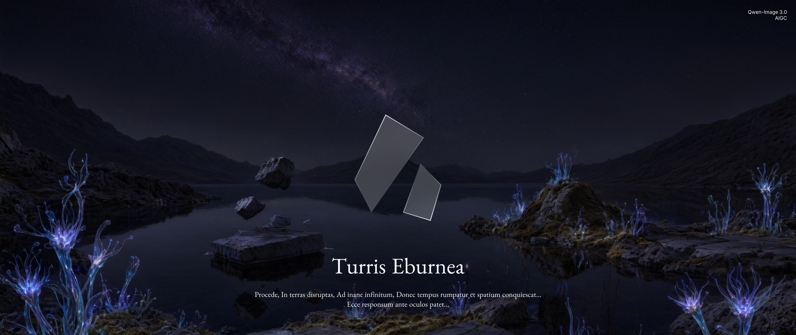

<div align="center">

# TurrisEburnea

> Procede, In terras disruptas, Ad inane infinitum, Donec tempus rumpatur et spatium conquiescat...
> Ecce responsum ante oculos patet...
>
> 向前，直入破碎之地，而入无穷虚空，直到时间破碎，空间停滞……答案已然眼前……
>
> [DEL THIS] 替换为 Slogan。

MacrosMeng 自用仓库模板，包含 README、Issue / PR 模板等内容。前往 [META Readme](meta.README.md) 查看元信息，本 Readme 其余信息均为模板内容。

[DEL THIS] 以一句话描述这个项目。

          

</div>

## 📚 关于

[DEL THIS] 描述这个项目的用处，包括简短功能介绍、支持平台等信息；试图解决的现实问题或目的；它的目标用户群体与非目标用户群体。

[DEL THIS] 在线尝试若有则放出。

## ✨ 特点

[DEL THIS] 这个项目与其他同类项目的差异之处、或是这条新赛道的意义；把重要、亮眼的功能写在这里。其他功能写在[路线图]。

## 🚀 快速开始

### 0. 确认条件

[Examples: ]

- TurrisEburnea 支持在以下平台上运行：
  - Windows 10 1803 及以上版本，x64 或 arm64 架构。
  - macOS Big Sur 及以上版本，仅 Apple Silicon 芯片。
  - 较为现代的 Linux 发行版；x64 或 arm64 架构，提供 .deb 与 AppImage 构建。
- 安装、运行 TurrisEburnea 需要稳定的互联网连接。
- TurrisEburnea 需要预装以下软件：
  - Python 3.12 及以上版本。
  - NodeJS 20 及以上版本，使用 pnpm 包管理器。

[DEL THIS] 描述此软件所需系统、架构、依赖软件等信息。

### 1. 下载与安装

[Example 1: ]

- 从 [Releases 页面](https://github.com/MacroMeng/TurrisEburneaTemplate/releases) 下载适用于你的操作系统的安装包 / 压缩包。
  - 比如，你使用 Windows 11 x64 操作系统，即下载 `turriseburnea-win-x64-v.0.0.0.exe` 文件。
  > [!WARNING]
  >
  > 在运行 / 打开任何从互联网获得的文件前，我们建议你先行核对其校验和是否与下载页提供的数据相符。
- 解压得到的压缩包。/ 启动得到的 exe 文件，按照提示操作。
- 打开压缩包中的 `TurrisEburnea.exe` 文件，即可启动此程序。 / 安装完成后，即可从系统中启动。
- 按照指引，完成 TurrisEburnea 基本配置。
  
[Example 2: ]

- 进入你项目的虚拟环境。
- 使用包管理器添加此包：
  - 使用 pip：

    ```bash
    pip install turriseburnea
    ```

  - 或者，使用 uv：

    ```bash
    uv add turriseburnea
    ```

- 你可以使用以下命令检测 TurrisEburnea 是否已经安装完毕：
  - 使用 pip：

    ```bash
    $ python -m turriseburnea --version
    TurrisEburnea (Windows x64 build) version 0.0.0
    ```

  - 或者，使用 uv：

    ```bash
    $ uv run turriseburnea --version
    TurrisEburnea (Windows x64 build) version 0.0.0
    ```

### 2. 基本使用

[Type 1 / 面向大众: ] [DEL THIS] 介绍软件最常使用的 2-3 个操作的：

- 触发方式。
- 应进行的操作。
- 能够得到的结果。

欲查看详细使用教程，请查阅 [使用文档](`[REPLACE THIS]`)。

[Type 2 / 面向开发者: ] [DEL THIS]

- 导入此库：

  ```python
  import turris_eburnea
  ```
[DEL THIS] 介绍基本 API。

## 📋 路线图

### 部分 1 [REPLACE THIS]

- [X] 已完成的功能 1
- [X] 已完成的功能 2
  - [X] 已完成的功能 2.1
  - [ ] 未完成的功能 2.2

### 部分 2 [REPLACE THIS]

- [X] 已完成的功能 3
- [ ] 未完成的功能 4

## 🗺️ 画廊

看看 TurrisEburnea 实际使用案例。[REPLACE THIS ↓]

|  |  |  |  |
| --- | --- | --- | --- |
| 场景 1 | 场景 2 | 场景 3 | 场景 4 |

## ❓ FAQs

[REPLACE THIS] Q: **Question 1?**

A: Answer 1.

Q: **Question 2?**

A: Answer 2.

## 💻 开发与贡献

本项目使用 [REPLACE THIS] 技术栈。推荐使用 [REPLACE THIS] 开发 TurrisEburnea。

本项目有以下项目架构：

```text
[REPLACE THIS] # 生成 tree，注释解释
```

如果你想参与贡献此项目：

- 安装 [REPLACE THIS] uv 命令行工具。
- Fork 此项目到你的 GitHub 账户名下。
- Clone 你的 Fork 到本地。
- [EXAMPLE] 在项目文件夹中，执行：
  
  ```bash
  uv venv
  source ./.venv/scripts/activate # 对于 *NIX 系统
  uv sync --dev
  ```

- 做出代码更改后，你可以使用：
  
  ```bash
  uv run main.py
  ```
  
  来运行此项目，测试效果；

  ```bash
  uv run pytest
  ```

  来进行测试。
- 完成更改后，向此仓库提交 Pull Request。
  > [!CAUTION]
  >
  > 无意义、低质量、或批量生成的 PR 均可能会被 **不加说明的关闭**，甚至可能导致你的 GitHub 账户被本仓库拉黑。

> [!INFO]
> 
> 有关更多参与贡献的文档，参阅 [贡献指南](CONTRIBUTING.md)。

## ⚖️ 许可、版权与引用

[EXAMPLE]

本项目使用 ... 许可证，这意味着：

- 你可以... [REPLACE THIS]
- 如果... 你需要...
- 你不能...
- 除此之外，你...
- 同时，作者...

本项目参考、引用、使用了如下项目的代码：

- **Proj 1** 引用范围
  - **源代码：** [Repo](`[REPLACE THIS]`)
  - **许可协议：** ...
- **Proj 2** 引用范围
  - **源代码：** [Repo](`[REPLACE THIS]`)
  - **许可协议：** ...
  - 修改后的源代码位于 [Link](`[REPLACE THIS]`)。

---

> <div align='center'> © 2026 | Owner </div>
